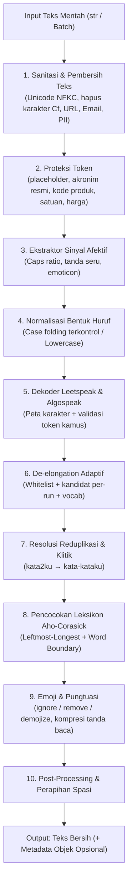
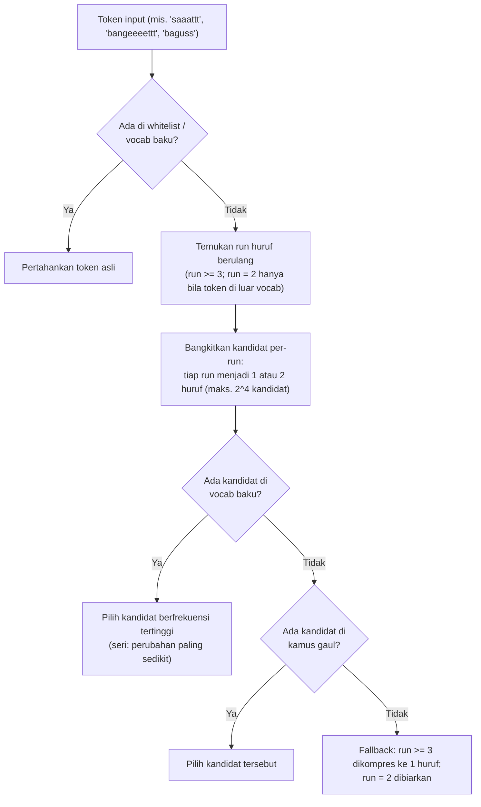

# 🇮🇩 IndoSlang-NLP: Arsitektur & Spesifikasi Rancangan Sistem

> **Pustaka Python Cepat, Deterministik, dan Modular untuk Normalisasi Bahasa Gaul, Singkatan, *Leetspeak*, dan Elongasi Kata pada Teks Media Sosial Indonesia.**

[](https://www.python.org/downloads/)
[](https://opensource.org/licenses/MIT)
[](https://github.com/psf/black)
[](https://github.com/astral-sh/ruff)
[-blue.svg)](https://mypy-lang.org/)
[](#-roadmap-pengembangan)
[](http://makeapullrequest.com)

> [!IMPORTANT]
> **Status Dokumen**: *Engineering Design Specification (Pre-Implementation)*. Dokumen ini merupakan blueprint perancangan arsitektur, spesifikasi teknis, standar perilaku (*edge case*), protokol data, dan metrik evaluasi. Belum ada kode program yang dijalankan. Seluruh angka target kinerja/akurasi dan seluruh tanda ✅ pada tabel perbandingan adalah **hipotesis desain**, bukan hasil pengukuran.

---

## 📑 Daftar Isi

1. [Ringkasan Proyek & Spesifikasi Teknis](#-ringkasan-proyek--spesifikasi-teknis)
2. [Latar Belakang Masalah](#-latar-belakang-masalah)
3. [Analisis Komparatif (State of the Art)](#-analisis-komparatif-state-of-the-art)
4. [Tujuan, Batasan, & Non-Tujuan](#-tujuan-batasan--non-tujuan)
5. [Fitur Utama & Keunggulan Komparatif](#-fitur-utama--keunggulan-komparatif)
6. [Arsitektur Pipeline & Urutan Eksekusi](#-arsitektur-pipeline--urutan-eksekusi)
7. [Spesifikasi Perilaku & Aturan Kasus Khusus (Edge Cases)](#-spesifikasi-perilaku--aturan-kasus-khusus-edge-cases)
8. [Desain Algoritma & Struktur Data](#-desain-algoritma--struktur-data)
9. [Pelestarian Sinyal Emosi & Ekstraksi Fitur Afektif](#-pelestarian-sinyal-emosi--ekstraksi-fitur-afektif)
10. [Desain Data, Akuisisi Kamus, & Tata Kelola Lisensi](#-desain-data-akuisisi-kamus--tata-kelola-lisensi)
11. [Desain Antarmuka Pemrograman (API Design)](#-desain-antarmuka-pemrograman-api-design)
12. [Ketahanan Sistem, Sanitasi Input, & Error Handling](#-ketahanan-sistem-sanitasi-input--error-handling)
13. [Etika, Privasi, & Moderasi Bertanggung Jawab (PII Masking)](#-etika-privasi--moderasi-bertanggung-jawab-pii-masking)
14. [Struktur Repositori & Standar Rekayasa Perangkat Lunak](#-struktur-repositori--standar-rekayasa-perangkat-lunak)
15. [Target Kinerja (SLA) & Strategi Pengujian](#-target-kinerja-sla--strategi-pengujian)
16. [Risiko, Asumsi, & Pertanyaan Terbuka](#-risiko-asumsi--pertanyaan-terbuka)
17. [Roadmap Pengembangan](#-roadmap-pengembangan)
18. [Panduan Kontribusi, Dokumentasi, & Sitasi Akademis](#-panduan-kontribusi-dokumentasi--sitasi-akademis)
19. [Glosarium & FAQ](#-glosarium--faq)

---

## 📌 Ringkasan Proyek & Spesifikasi Teknis

| Parameter | Spesifikasi |
|---|---|
| **Nama Paket** | `indoslang-nlp` (namespace impor: `indoslang`) |
| **Bahasa & Runtime** | Python 3.10 s/d 3.13 (CPython; kompatibilitas PyPy belum diverifikasi; Python 3.9 sudah EOL) |
| **Paradigma Arsitektur** | Lexicon-Driven + Rule-Based State Machine + Trie/Aho-Corasick Indexing |
| **Ketergantungan Eksternal Minimal** | `ahocorasick-rs` (matching cepat; cadangan trie murni-Python), `regex`; `pydantic` hanya untuk validasi skema kamus (dev/CI, tidak wajib saat runtime) |
| **Integrasi Opsional** | `scikit-learn`, `pandas`, `polars`, `datasets` (HuggingFace) |
| **Target Pengguna** | Peneliti NLP, mahasiswa tugas akhir/skripsi, Data Scientist, tim Trust & Safety / Moderasi Konten |
| **Lisensi Perangkat Lunak** | MIT License |


### Contoh Penggunaan Cepat
> [!NOTE]
> Ilustrasi rancangan API; paket belum dirilis.

```bash
pip install indoslang-nlp
```

```python
from indoslang import IndoNormalizer

normalizer = IndoNormalizer()
print(normalizer.normalize("gw mager bangeeet, bsk ktmuan yaa"))
# "saya malas gerak banget, besok ketemuan ya"
```

---

## 🎯 Latar Belakang Masalah

Dalam pemrosesan bahasa alami (NLP) untuk Bahasa Indonesia, teks dari media sosial (X/Twitter, Instagram, TikTok) dan ulasan *e-commerce* memiliki karakteristik informalitas yang sangat tinggi. Model modern berbasis representasi subkata (*WordPiece*, *BPE*) seperti **IndoBERT** maupun ekstraktor fitur klasik seperti **TF-IDF** mengalami penurunan performa signifikan akibat masalah OOV (*Out-of-Vocabulary*) dan fragmentasi token berlebih (*over-tokenization*).

```
Teks Mentah: "@budi_99 JUJURLY gw mager bangeeeettt ikut f0rum itu, org2nya pd t0x1c bgt 😭😭!! call me 0812345678"
                                              │
                    ┌─────────────────────────┴────────────────────────┐
                    ▼                                                  ▼
     [Model Klasik (TF-IDF)]                              [Model Neural (IndoBERT)]
- 'bangeeeettt' tidak dikenali (OOV)                 - Terpecah menjadi banyak token:
- 't0x1c' dianggap entitas asing                      ['bang', '##eee', '##ett', 't0', '##x1', '##c']
- Kosakata membengkak secara sparse                   - Menghabiskan panjang konteks (max_seq_len)
- Akurasi klasifikasi turun drastis                   - Penurunan inferensi semantik
```

> [!NOTE]
> Pecahan token IndoBERT di atas bersifat **ilustratif**, bukan keluaran tokenizer yang sudah diverifikasi. Sebelum dipakai di makalah/skripsi, ganti dengan hasil tokenisasi nyata dari tokenizer yang dirujuk (sebutkan nama model dan versinya).

---

## 📊 Analisis Komparatif (State of the Art)

Berikut perbandingan posisi `IndoSlang-NLP` terhadap perangkat lunak pemrosesan teks Bahasa Indonesia yang ada saat ini:

| Dimensi Fitur | Sastrawi / PySastrawi | Colloquial Lexicon (Salsabila et al.) | IndoSlang-NLP (Rancangan Ini) |
|---|---|---|---|
| **Fokus Utama** | Lemmatization & Stemming kata dasar baku | Kamus statis mapping kata | Normalisasi komprehensif end-to-end |
| **Kecepatan Pencocokan** | Tidak relevan (stemmer, bukan pencocok leksikon) | Bergantung implementasi pengguna | Target $O(N+Z)$ berbasis Aho-Corasick (pembanding naif: `re.sub` per entri, $O(K \times M)$) |
| **De-elongation Cerdas** | ❌ Tidak ada | ❌ Tidak ada | ✅ Dua jalur (whitelist + fallback kamus) |
| **Dekoder Leetspeak** | ❌ Tidak ada | ❌ Tidak ada | ✅ Disambiguasi berbasis kandidat valid |
| **Reduplikasi Jamak (`org2`)** | ➖ Hanya untuk stemming | ❌ Tidak ada | ✅ Resolusi klitik morfologis (`org2nya` → `orang-orangnya`) |
| **Pelestarian Sinyal Emosi** | ❌ Hilang | ❌ Tidak ada | ✅ Ekstraksi metadata afektif terpisah |
| **Integrasi Scikit-Learn** | ❌ Perlu custom wrapper manual | ❌ File data mentah saja | ✅ `IndoSlangTransformer` native pipeline |
| **Mode Audit (Traceability)** | ❌ *Black-box* | ❌ Manual | ✅ Mode `trace=True` step-by-step |
| **Penanganan PII (Privasi)** | ❌ Tidak ada | ❌ Tidak ada | ✅ Masking otomatis `@mention`, email, no. telp |

> [!NOTE]
> Sastrawi adalah *stemmer*, jadi lebih tepat dipandang sebagai **pelengkap** (dipakai setelah normalisasi) ketimbang pesaing; ❌ pada kolomnya berarti fitur itu di luar cakupannya, bukan kekurangan. Semua ✅ pada kolom IndoSlang-NLP adalah **target desain**. Sebelum rilis, tambahkan baseline yang lebih relevan (normalizer `re.sub` naif dan sumber/dataset normalisasi lain, mis. IndoCollex) dan verifikasi setiap klaim terhadap sumbernya.

---

## 🧭 Tujuan, Batasan, & Non-Tujuan

### Tujuan Utama
1. **Reduksi OOV Signifikan:** Menurunkan tingkat token tidak terdaftar (OOV) sedikitnya 50% pada teks media sosial (hipotesis awal; definisi OOV dan korpus uji ada pada bagian Metrik Evaluasi).
2. **Kecepatan Tinggi (Throughput):** Target awal ≥ 35.000 kalimat/detik (optimal ≥ 60.000) pada satu core CPU standar; angka baku dan protokol pengukuran ada pada bagian Target Kinerja.
3. **Deterministik & Dapat Dilacak (*Explainable*):** Setiap perubahan kata dapat diverifikasi sumber aturan dan langkah eksekusinya.
4. **Zero-Destruction for Valid Words:** Tidak merusak kata baku asli yang memiliki huruf rangkap (misal: *saat, taat, maaf, cemooh, massa*).

### Batasan Sistem (*Boundaries*)
- Berfokus pada Bahasa Indonesia ragam informal/gaul umum, singkatan internet, serta serapan daerah populer (Jaksel, Jawa Timuran, Sunda umum).
- Tidak melakukan analisis sintaksis hierarkis penuh (*dependency parsing*).

### Non-Tujuan (*Out of Scope*)
- **Bukan Pengganti Stemmer:** Tidak menggantikan peran *stemmer* KBBI (tidak memotong prefiks/sufiks baku seperti *meng-, -kan*).
- **Bukan Model Generatif/Seq2Seq:** Menghindari penggunaan LLM/Neural berat saat runtime agar tetap ringan, dapat berjalan lokal, dan berbiaya komputasi nol.
- **Bukan Mesin Penerjemah Bahasa Daerah Lengkap:** Tidak bertujuan menerjemahkan kalimat utuh bahasa Jawa krama inggil atau Sunda halus ke bahasa Indonesia.

---

## ✨ Fitur Utama & Keunggulan Komparatif

1. **Pipeline Pembersihan Teks Bertahap:** Pembersihan URL, mention, hashtag, dan karakter terdistorsi secara modular.
2. **Kompilasi Trie Aho-Corasick:** Pencocokan leksikon multi-kata dalam satu kali lintasan (*single-pass scanning*).
3. **De-elongation Kontekstual Berbasis Whitelist:** Mengurangi perpanjangan karakter berulang (`bangeeet` $\rightarrow$ `banget`, `haaaaai` $\rightarrow$ `hai`) tanpa merusak `maaf`.
4. **Disambiguasi Leetspeak / Algospeak:** Mengubah teks sandi/samaran (`4nj1ng` $\rightarrow$ `anjing`, `b0d0h` $\rightarrow$ `bodoh`) dengan validasi kosakata agar angka kuantitatif (`2024`, `100rb`) tidak terkonversi sembarangan.
5. **Resolusi Reduplikasi Klitik:** Mendukung pola angka 2 informal bersambung afiks (`temen2ku` $\rightarrow$ `teman-temanku`, `buku2` $\rightarrow$ `buku-buku`).
6. **Mode Kebijakan Ambiguitas (Conservative vs. Aggressive):** Memberikan kendali penuh pada pengguna untuk kata bermakna ganda.
7. **Extractor Fitur Afektif Terpisah:** Memisahkan data teks bersih sambil mempertahankan sinyal emosi (intensitas huruf kapital, jumlah tanda seru, intensitas elongasi) untuk keperluan analisis sentimen.
8. **Sklearn & Dataframe Native Ready:** Kompatibel penuh dengan ekosistem data science (`scikit-learn.pipeline.Pipeline`, `pandas.Series`, `polars.Expr`).


### Skenario Penggunaan
| Skenario | Peran IndoSlang-NLP | Catatan |
|---|---|---|
| Analisis sentimen (TF-IDF / SVM) | Mengurangi sparsity kosakata | Aktifkan `extract_features` agar sinyal emosi tidak hilang |
| Deteksi ujaran kebencian / cyberbullying | Membuka bentuk samaran (`g!la`, `b0d0h`) | Kata kasar tidak disensor; gunakan mode `conservative` untuk audit |
| Topic modelling & clustering | Menyatukan variasi ejaan satu kata | Jalankan stemmer setelah normalisasi |
| Pencarian / retrieval teks informal | Menyamakan bentuk query dan dokumen | Simpan teks asli berdampingan dengan hasil normalisasi |
| Persiapan data fine-tuning IndoBERT | Opsional; manfaat perlu diuji | Bandingkan dengan dan tanpa preprocessing |

---

## 🏗️ Arsitektur Pipeline & Urutan Eksekusi

Urutan pemrosesan bersifat kritikal (*order-dependent*). Jika leksikon dijalankan sebelum leetspeak, maka `b0d0h` tidak akan pernah cocok dengan kamus kata gaul.



**Catatan desain pipeline:**
- **Proteksi Token (tahap 2)** wajib berjalan sebelum leetspeak, de-elongation, dan reduplikasi; tanpa itu `mp4` atau `3x` bisa terbaca sebagai leetspeak, dan placeholder seperti `<PHONE>` ikut di-*lowercase* (lihat bagian Edge Cases §6).
- **Fitur afektif** dihitung dari dua sumber: fitur level-teks (rasio kapital, tanda seru, emoticon) diambil pada tahap 3 dari teks yang sudah dibersihkan; fitur level-token (elongasi) dikumpulkan sebagai *event* oleh tahap 6, karena baru di sana diketahui token mana yang benar-benar diubah.
- Emoji dan kompresi tanda baca berada di tahap 9 agar penghitungan emoticon/tanda seru pada tahap 3 tidak terpengaruh.


### Contoh Jalan Lengkap (*End-to-End Walkthrough*)
Input: `WOII @user_99 jgn mager bangeeettt, bsk ktmuan yaa!! 😭 kontak: 08123456789` (konfigurasi bawaan, `extract_features=True`).

| Tahap | Hasil |
|---|---|
| 1. Sanitasi & PII | `WOII <USER> jgn mager bangeeettt, bsk ktmuan yaa!! 😭 kontak: <PHONE>` |
| 2. Proteksi token | `<USER>` dan `<PHONE>` ditandai terproteksi |
| 3. Fitur afektif | `caps_ratio` ≈ 0.11, `exclamation_count` = 2, `emoticon_negative_count` = 1 |
| 4. Case folding | `woii <USER> jgn mager bangeeettt, bsk ktmuan yaa!! 😭 kontak: <PHONE>` |
| 5. Leetspeak | Tidak ada perubahan |
| 6. De-elongation | `woi <USER> jgn mager banget, bsk ktmuan ya!! 😭 kontak: <PHONE>` |
| 7. Reduplikasi | Tidak ada perubahan |
| 8. Leksikon | `woi <USER> jangan malas gerak banget, besok ketemuan ya!! 😭 kontak: <PHONE>` |
| 9. Emoji & pungtuasi | Tidak berubah (`emoji="ignore"`, `!!` sudah ≤ 2) |
| 10. Post-processing | `woi <USER> jangan malas gerak banget, besok ketemuan ya!! 😭 kontak: <PHONE>` |

---

## ⚙️ Spesifikasi Perilaku & Aturan Kasus Khusus (Edge Cases)

### 1. Kebijakan Kata Ambigu (*Ambiguity Policy*)
Terdapat kata informal yang memiliki makna ganda tergantung konteks:
- `ml`: bisa berarti *Mobile Legends* (gaming), *mililiter*, atau singkatan chat lain.
- `pp`: bisa berarti *profile picture* atau *pulang-pergi*.
- `sm`: bisa berarti *sama* (dengan) atau *social media* / *short message*.
- `cm`: bisa berarti *cuma* (hanya) atau satuan ukur *sentimeter*.
- `sma`: bisa berarti *sama* (informal) atau *SMA* (Sekolah Menengah Atas). Kata baku homonim seperti `bisa` (*dapat* / racun) tidak menjadi entri leksikon karena tidak diubah.

**Sistem menyediakan 3 mode (parameter `ambiguity_mode`):**
1. `ambiguity_mode="conservative"` (Default aman untuk riset umum): Hanya menerapkan entri ber-`confidence` ≥ 0.98 dan `ambiguous=false` pada kamus (probabilitas salah-ubah mendekati nol). Kata ambigu tingkat tinggi dibiarkan kecuali ada dalam kamus frasa terikat (`cm kamu` $\rightarrow$ `cuma kamu`).
2. `ambiguity_mode="aggressive"` (Cocok untuk teks media sosial ekstrem): Mengonversi seluruh kandidat leksikon ke padanan informal paling dominan.
3. `ambiguity_mode="context_aware"` (Terencana v0.3+): Menggunakan model frekuensi n-gram lokal untuk menentukan probabilitas transisi token sebelumnya dan sesudahnya.

### 2. Penanganan Kapitalisasi & Entitas Bernama (Named Entities)
- Parameter bawaan `preserve_acronyms=True`: Kata dengan semua huruf kapital (all-caps) sepanjang $\le 4$ karakter yang cocok dengan daftar akronim resmi (*BCA, BNI, DKI, DPR, BMKG, WHO, PBB*) tidak diubah menjadi huruf kecil atau dicocokkan ke kamus gaul.
- Parameter `lowercase=True` menjalankan standardisasi *case folding* setelah pengecekan proteksi entitas.

### 3. Morfologi, Klitik, dan Reduplikasi Kompleks
Masyarakat Indonesia sering menggabungkan reduplikasi angka 2 dengan klitik pronomina:
- Pola 1 (Kata dasar + '2'): `orang2` $\rightarrow$ `orang-orang`, `buku2` $\rightarrow$ `buku-buku`.
- Pola 2 (Kata dasar + '2' + Enklitik `-nya/-ku/-mu`): `temen2nya` $\rightarrow$ `teman-temannya`, `mobil2ku` $\rightarrow$ `mobil-mobilku`.
- Pengecualian Numerik (*Exclusion Filter*): Token matematika atau kode produk seperti `h2h`, `co2`, `v8`, `mp4`, `4k`, `3x` diproteksi dari aturan reduplikasi.

### 4. Percampuran Bahasa (*Code-Mixing / Indoglish*)
- Kata-kata bahasa Inggris populer yang sering disisipkan ke percakapan Jakarta Selatan (*which is, literally, preferred, even, basically, honest review*) **tidak dipaksa** diartikan ke bahasa Indonesia baku secara literal jika akan merusak nuansa teks asli, kecuali pengguna mengaktifkan parameter `translate_indoglish=True`.
- Secara default, frasa serapan tersebut dipertahankan bentuknya (*pass-through*).

### 5. Normalisasi Karakter, Pungtuasi, & Emoji
- **Unicode NFKC:** Standarisasi representasi glif, termasuk huruf bergaya yang sering dipakai di Instagram/TikTok (`𝗕𝗔𝗡𝗚𝗘𝗧` → `BANGET`) dan huruf *full-width*. NFKC **tidak** menghapus karakter tak terlihat, jadi karakter format (*zero-width*, kategori *Cf*) dihapus secara eksplisit, kecuali ZWJ di dalam urutan emoji yang dipertahankan sampai tahap emoji.
- **Tanda Baca Berulang:** `????` atau `!!!!` dikompresi menjadi satu tanda baca (atau batas maksimal 2 jika opsi sinyal emosi aktif).
- **Mode Emoji:**
  - `emoji="ignore"`: Membiarkan karakter emoji apa adanya.
  - `emoji="remove"`: Menghapus seluruh karakter emoji.
  - `emoji="demojize"`: Mengubah emoji menjadi representasi token teks Bahasa Indonesia (contoh: `😭` $\rightarrow$ `<EMOJI_MENANGIS>`, `👍` $\rightarrow$ `<EMOJI_JEMPOL>`).
  - Nilai bawaan: `emoji="ignore"`. Format token `<EMOJI_...>` sengaja seragam dengan `<USER>`/`<PHONE>` dan ikut diproteksi dari *case folding*.

### 6. Proteksi Token (*Protected Tokens*)
Sebelum tahap leetspeak, de-elongation, dan reduplikasi, token berikut ditandai terproteksi dan dilewati oleh ketiga tahap itu:
- Placeholder sistem: `<USER>`, `<PHONE>`, `<EMAIL>`, `<EMOJI_*>` (juga tidak di-*lowercase*).
- Akronim resmi pada `official_acronyms.txt`.
- Kode produk, satuan, harga, dan tahun: `mp4`, `v8`, `4k`, `3x`, `co2`, `h2h`, `10rb`, `50k`, `2024`, `covid19`.

Filter pengecualian pada §3 hanya melindungi reduplikasi; tahap ini memperluasnya ke seluruh mesin transformasi.

### 7. Pola Informal Tambahan (Keputusan Desain Terbuka)
- **Tawa berpola** (`wkwkwk`, `hahaha`, `xixixi`, `awokwok`): ini pengulangan suku kata, bukan elongasi huruf, sehingga tidak tertangani de-elongation. Usulan: modul kecil yang memampatkan unit berulang (`wkwkwkwk` → `wkwk`) dengan maksimal 2 unit.
- **Afiksasi gaul** (`ngerjain`, `bikinin`, `kepikiran`, `dikasih`): perlu garis batas yang tegas terhadap Non-Tujuan "bukan stemmer". Usulan: afiks *baku* di luar cakupan, afiks *gaul* ditangani lewat entri leksikon (v0.1) dan aturan afiks terbatas (v0.2+).
- **Kata kasar/profanitas:** dinormalisasi seperti kata lain, **tidak** disensor atau dihapus (`category: "profanity"`), karena riset ujaran kebencian membutuhkan teks utuh.

---

## 🧠 Desain Algoritma & Struktur Data

### 1. Pencocokan Leksikon Multi-Kata (Aho-Corasick Automaton)
Penggantian kata menggunakan `re.sub` sebanyak ribuan kali memiliki kompleksitas $O(K \times M)$ ($K$ = jumlah kata kamus, $M$ = panjang teks), yang sangat lambat pada dataset besar. 

`IndoSlang-NLP` menggunakan struktur pohon **Trie** dengan algoritma **Aho-Corasick**:
- Membangun *finite-state machine* dari seluruh kamus leksikon saat inisialisasi.
- Kompleksitas waktu pemindaian hanya **$O(N + Z)$** ($N$ = panjang kalimat teks, $Z$ = jumlah kemunculan kecocokan).
- Menerapkan aturan **Longest-Match First**: Frasa bertingkat seperti `"tidak apa apa"` diprioritaskan sebelum token parsial `"tidak"`.
- Validasi **Word Boundary ($\b$)**: Menghindari substitusi di tengah kata (misal: singkatan `yg` tidak mengganti suku kata dalam `tayg`). Aho-Corasick pada dasarnya mengembalikan kecocokan *substring*, sehingga batas kata diperiksa sebagai filter pasca-pencocokan, dan semantik *leftmost-longest* dipilih saat membangun automaton.

### 2. Algoritma De-elongation (Kandidat Per-Run)

Kompresi seragam ("semua run jadi 1 huruf" atau "semua run jadi 2 huruf") gagal pada kata yang punya satu huruf kembar sah **dan** satu huruf yang dipanjangkan, misalnya `saaattt` → `saat`. Karena itu setiap *run* huruf berulang dievaluasi sendiri-sendiri.



| Input | Kandidat (sebagian) | Hasil |
|---|---|---|
| `bangeeeettt` | `banget`, `bangett`, `bangeet`, `bangeett` | `banget` |
| `maaaaf` | `maf`, `maaf` | `maaf` |
| `saaattt` | `sat`, `saat`, `satt`, `saatt` | `saat` |
| `baguss` (run = 2, di luar vocab) | `bagus` | `bagus` |

**Daftar Putih (*Whitelist*) Kata Rangkap:**
Berkas `indoslang/data/rules/whitelist_elongation.txt` memuat kata sah Bahasa Indonesia dengan huruf kembar, antara lain: `maaf, saat, taat, cemooh, naas, massa, illahi, koordinasi, zoologi, seekor, keenam, keempat`. Daftar ini **dibangkitkan otomatis** dari `id_vocab_baku.txt` (semua kata yang mengandung huruf kembar), bukan dikurasi manual, agar tidak ada kata yang terlewat.

### 3. Dekoder Leetspeak & Algospeak dengan Verifikasi Kosakata
Dekoder leetspeak tidak boleh bekerja secara buta (*blind substitution*) karena dapat merusak data numerik yang valid (misal: `100` atau `covid19`).

**Mekanisme:**
1. Evaluasi token: jika token adalah angka murni (`^\d+$`) atau token terproteksi (kode produk `mp4`, `v8`, `4k`; satuan; harga `10rb`, `50k`; tahun `2024`; lihat Edge Cases §6), **lewati proses**.
2. Jika token memuat kombinasi huruf dan angka/simbol (contoh: `b0d0h`, `4nj1ng`, `g!la`):
   - Bangun kandidat string melalui tabel substitusi: `0` $\rightarrow$ `o`, `1` $\rightarrow$ `[i, l]`, `3` $\rightarrow$ `e`, `4` $\rightarrow$ `a`, `5` $\rightarrow$ `s`, `7` $\rightarrow$ `t`, `!` $\rightarrow$ `i`, `@` $\rightarrow$ `a`, `$` $\rightarrow$ `s`.
   - Lakukan pencarian kecocokan kandidat terhadap kosakata kata baku atau kamus kata gaul.
   - Pilih kandidat berfrekuensi tertinggi di vocab/kamus; jika seri, tandai ambigu pada jejak (`trace`). Jika tidak ada yang cocok, kembalikan token asli tanpa mutasi (mis. `covid19` tetap `covid19`).
   - Batasi ledakan kombinatorial: karakter ambigu seperti `1 → [i, l]` dibatasi maksimal 2^6 kandidat per token. Peta lengkap berada di `leetspeak_map.json`.

---

## 🎭 Pelestarian Sinyal Emosi & Ekstraksi Fitur Afektif

Dalam riset analisis sentimen dan deteksi ujaran kebencian (*hate speech*), elongasi kata dan penggunaan huruf kapital merupakan indikator penting intensitas emosi. Menghapus karakteristik ini sepenuhnya dapat merugikan model prediktif.

`IndoSlang-NLP` menyediakan fitur **Affective Feature Extraction**:

```python
from indoslang import IndoNormalizer

normalizer = IndoNormalizer(extract_features=True)
doc = normalizer.process("PARAHHH BANGEEETTT SIHHH GAK JELAS BGT!!! 😡😡")

# Teks yang telah dinormalisasi
print(doc.text)
# Output: "parah banget sih tidak jelas banget!! 😡😡"   (emoji="ignore"; "!!!" dikompresi ke maks. 2 saat fitur afektif aktif)

# Metadata fitur afektif untuk dimasukkan ke model Machine Learning
print(doc.features)
# Output:
# {
#   "elongation_count": 3,           # Tiga kata mengalami pemanjangan huruf
#   "elongated_tokens": ["parah", "banget", "sih"],
#   "caps_ratio": 1.0,               # huruf kapital / total huruf (berteriak)
#   "exclamation_count": 3,          # dihitung sebelum kompresi tanda baca
#   "question_count": 0,
#   "emoticon_negative_count": 2     # Dua emoji kemarahan terdeteksi
# }
```

**Definisi fitur:** `caps_ratio` = jumlah huruf kapital ÷ jumlah huruf (angka/spasi/tanda baca/emoji tidak dihitung); `exclamation_count` dan `question_count` dihitung dari teks asli sebelum kompresi; `elongated_tokens` berisi bentuk setelah dinormalisasi. Contoh sebelumnya memakai `0.88`, yang tidak cocok dengan definisi mana pun untuk kalimat itu (semua hurufnya kapital).

---

## 🗃️ Desain Data, Akuisisi Kamus, & Tata Kelola Lisensi

### 1. Struktur Skema JSON Kamus Resmi
Setiap berkas leksikon divalidasi ketat menggunakan `pydantic` (di CI) dan JSON Schema terpisah di `indoslang/data/schema/lexicon.schema.json`; kunci `$schema` tidak diletakkan di dalam berkas kamus agar tidak tercampur dengan entri kata. Satu kata dapat memiliki beberapa *sense* (`senses`) karena JSON tidak mengizinkan kunci ganda, padahal kata ambigu seperti `cm` memerlukan lebih dari satu padanan.

```json
{
  "mager": {
    "senses": [
      {"normalized": "malas gerak", "category": "slang", "confidence": 1.0}
    ],
    "ambiguous": false,
    "source": "manual_curation",
    "license": "CC-BY-SA-4.0"
  },
  "cm": {
    "senses": [
      {"normalized": "cuma", "category": "abbreviation", "confidence": 0.75, "context_hint": ["cm kamu", "cm satu"]},
      {"normalized": "sentimeter", "category": "unit", "confidence": 0.25, "context_hint": ["\\d+ ?cm"]}
    ],
    "ambiguous": true,
    "source": "colloquial_lexicon_salsabila",
    "license": "MIT"
  }
}
```

*Nilai `license` pada contoh hanya ilustrasi; isi sebenarnya harus diverifikasi dari sumber masing-masing.*

**Aturan validasi tambahan di CI:**
- `confidence` bernilai 0–1 dan jumlah `confidence` seluruh `senses` ≈ 1.
- **Anti-rantai:** nilai `normalized` tidak boleh menjadi kunci entri lain (A → B → C), agar normalisasi bersifat idempoten.
- Tidak ada kunci duplikat lintas berkas kecuali dideklarasikan sebagai *override*.
- Setiap entri wajib memuat `source`, `license`, dan minimal satu contoh kalimat.

### 2. Strategi Akuisisi 1.000+ Entri Awal
Untuk meminimalkan risiko lisensi (jaminan penuh baru dapat diberikan setelah audit lisensi tiap sumber):
1. **Leksikon Terbuka Berlisensi Jelas:**
   - *Colloquial Indonesian Lexicon* (Salsabila et al.): Berisi ~2.000 pasangan kata gaul dengan lisensi akademik terbuka.
   - *Kamus Alay / Singkatan Twitter* dan SentiStrength-ID corpus (**verifikasi atribusi penulis dan lisensi sebelum dipakai**).
2. **Kurasi Manual Mandiri (In-House Dataset):**
   - Penambahan 500+ istilah kekinian (Tiktok/X slang) yang belum ada di korpus lama (contoh: *fomo, yapping, skibidi, tubir, menye-menye, salfok*).
3. **Penyaringan KBBI Baku:**
   - Memverifikasi kata hasil normalisasi terhadap daftar kata baku. KBBI Daring (Badan Bahasa) memiliki ketentuan penggunaan sendiri, jadi daftar kata turunannya tidak didistribusikan ulang; KBBI dipakai sebatas rujukan kurasi manual, sedangkan `id_vocab_baku.txt` dibangun dari sumber berlisensi terbuka (mis. daftar frekuensi dari korpus Wikipedia Indonesia; periksa lisensi masing-masing).

### 3. Pemisahan Versi Kode vs Versi Data Kamus (*Independent Versioning*)
- Paket kode menggunakan versi semantik standar: `v0.1.0`.
- Data kamus menggunakan penomoran rilis berbasis tanggal: `indoslang-dict-2026.11.json`.
- Pengguna dapat memperbarui basis data kamus tanpa harus menginstal ulang pustaka utama menggunakan perintah:
  `indoslang update-dicts`
- Karena perintah ini mengunduh data dari jaringan, pengamanannya wajib: hanya lewat HTTPS dari rilis resmi, verifikasi checksum SHA-256 (idealnya tanda tangan), opsi `--offline`, serta penyimpanan di direktori data pengguna (mis. via `platformdirs`), bukan di dalam paket terpasang.

---

## 💻 Desain Antarmuka Pemrograman (API Design)

### 1. Inisialisasi & Penggunaan Intuitif

```python
from indoslang import IndoNormalizer

# Inisialisasi dengan opsi lengkap
normalizer = IndoNormalizer(
    ambiguity_mode="conservative",     # 'conservative' | 'aggressive' | 'context_aware' (rencana)
    fix_elongation=True,               # Normalisasi huruf berulang
    fix_leetspeak=True,                # Dekode angka/simbol pengganti huruf
    expand_reduplication=True,         # Resolusi kata2 -> kata-kata
    clean_social_tags=True,            # Bersihkan @mention, URL, #hashtag
    mask_pii=True,                     # Samarkan nomor HP dan email
    emoji="demojize",                  # 'ignore' | 'remove' | 'demojize'
    preserve_acronyms=True,            # Proteksi akronim resmi (BCA, DKI)
    extra_lexicons=["./kamus_regional_jawa.json"], # Kamus tambahan kustom
)

raw_text = "WOII @user_99 jgn mager bangeeettt, bsk ktmuan di Jaksel yaa! no wa 08123456789"
clean_text = normalizer.normalize(raw_text)

print(clean_text)
# Output: "woi <USER> jangan malas gerak banget, besok ketemuan di jakarta selatan ya! nomor whatsapp <PHONE>"
```

**Parameter utama dan nilai bawaan:**

| Parameter | Default | Keterangan |
|---|---|---|
| `ambiguity_mode` | `"conservative"` | `conservative` / `aggressive` / `context_aware` (rencana) |
| `fix_elongation` | `True` | De-elongation per-run |
| `fix_leetspeak` | `True` | Dekode leetspeak dengan validasi vocab |
| `expand_reduplication` | `True` | `kata2` → `kata-kata` |
| `clean_social_tags` | `True` | Bersihkan URL, `@mention`, `#hashtag` |
| `mask_pii` | `True` | Privasi secara bawaan |
| `emoji` | `"ignore"` | `ignore` / `remove` / `demojize` |
| `preserve_acronyms` | `True` | Proteksi akronim resmi |
| `lowercase` | `True` | *Case folding* setelah proteksi entitas |
| `translate_indoglish` | `False` | Padanan bahasa Indonesia untuk code-mixing |
| `extract_features` | `False` | Aktifkan ekstraksi fitur afektif |
| `extra_lexicons` | `None` | Kamus tambahan; prioritas di atas kamus bawaan |

**Kontrak tipe kembalian (konsisten):** `normalize(text) -> str` selalu mengembalikan string; `process(text, trace=False) -> NormalizedDoc` mengembalikan objek berisi `text`, `features`, dan `trace_steps`; `transform_batch(list[str]) -> list[str]`. Tipe kembalian tidak boleh berubah hanya karena sebuah flag.

### 2. Mode Jejak Transparan (*Audit & Explainability Trace*)

```python
# Menelusuri rantai mutasi kata untuk keperluan analisis/debugging
result = normalizer.process(raw_text, trace=True)

print(result.text)
for step in result.trace_steps:
    print(f"[{step.stage}] Modifikasi: {step.original_token} -> {step.transformed_token} (Pemicu: {step.rule_source})")
```

### 3. Pemrosesan Data Skala Besar (Pandas & Polars Batch Processing)

```python
import pandas as pd
from indoslang import IndoNormalizer

df = pd.DataFrame({"ulasan": ["produknya bgs bgt bangeeet", "pelayanan kureeenggg"]})
normalizer = IndoNormalizer()

# Eksekusi multithreaded / vectorized batch
df["ulasan_bersih"] = normalizer.transform_batch(
    df["ulasan"].tolist(),
    n_jobs=4,            # Parallel multiprocessing
    batch_size=1000
)
```

### 4. Integrasi Pipeline Scikit-Learn

```python
from sklearn.pipeline import Pipeline
from sklearn.feature_extraction.text import TfidfVectorizer
from sklearn.naive_bayes import MultinomialNB
from indoslang.sklearn import IndoSlangTransformer

# Kompatibel penuh dengan scikit-learn grid-search
nlp_pipeline = Pipeline([
    ("indoslang", IndoSlangTransformer(fix_elongation=True, ambiguity_mode="conservative")),
    ("tfidf", TfidfVectorizer(ngram_range=(1, 2))),
    ("classifier", MultinomialNB())
])

# nlp_pipeline.fit(X_train_raw, y_train)
```

### 5. Antarmuka Baris Perintah (CLI)

```bash
# Memproses berkas secara langsung melalui terminal
indoslang normalize \
    --input dataset_mentah.csv \
    --column teks_ulasan \
    --output dataset_bersih.csv \
    --workers 4 \
    --emoji demojize
```

### 6. Reproduksibilitas, Konfigurasi, & Versi
Hasil normalisasi bergantung pada versi kode **dan** versi kamus, sehingga riset yang dapat direproduksi perlu mencatat keduanya.

```python
doc = normalizer.process(raw_text)
print(doc.meta)
# {"lib_version": "0.1.0", "dict_version": "2026.11", "config_hash": "a3f9c2e1"}

# Kunci versi kamus agar hasil eksperimen tidak berubah saat kamus diperbarui
normalizer = IndoNormalizer(dict_version="2026.11")

# Konfigurasi dari berkas
normalizer = IndoNormalizer.from_config("indoslang.toml")
```

```toml
# indoslang.toml
ambiguity_mode = "conservative"
emoji = "demojize"
mask_pii = true
extra_lexicons = ["./kamus_regional_jawa.json"]
```

**Kebijakan versi:**
- Kode mengikuti SemVer. Selama pra-1.0, perubahan perilaku normalisasi (bukan hanya perubahan API) dicatat di `CHANGELOG.md` sebagai perubahan penting.
- Fitur yang akan dihapus ditandai `DeprecationWarning` minimal satu rilis minor sebelum dihapus.
- Pemanggilan `transform_batch` pada input besar mencatat ringkasan (jumlah teks, non-string yang dilewati, waktu) melalui modul `logging` standar, tanpa pernah mencatat isi teks pengguna (privasi).

---

## 🛡️ Ketahanan Sistem, Sanitasi Input, & Error Handling

1. **Non-String Input Safety:** Jika input berupa `None`, `NaN`, integer, atau float, sistem tidak melempar eksepsi *crash*; sistem secara aman mengembalikan string kosong atau melakukan *typecast* string disertai catatan log peringatan.
2. **Proteksi Teks Berukuran Ekstrem (*ReDoS Prevention*):** Menghindari ekspresi reguler yang rentan *catastrophic backtracking*. Teks dengan panjang $> 50.000$ karakter dibagi menjadi chunk kalimat secara aman.
3. **Pembersihan Glif Ilegal (*Zalgo & Invisible Characters*):** Menghapus karakter Unicode kategori format (*Cf*), penggantian karakter khusus, dan *combining characters* berlebih yang sengaja dibuat untuk merusak visual atau sistem tokenizer.
4. **Keamanan Konkurensi:** Automaton dan kamus bersifat *immutable* setelah dibangun sehingga aman dipakai lintas *thread*. Untuk `n_jobs > 1`, pastikan objek dapat di-*pickle* atau dibangun ulang per *worker* (verifikasi dukungan *pickle* pada `ahocorasick-rs`).
5. **Batas Sumber Daya:** Jumlah kandidat leetspeak dan de-elongation dibatasi (lihat bagian algoritma) agar waktu proses per token tetap terbatas pada input adversarial.

---

## 🔒 Etika, Privasi, & Moderasi Bertanggung Jawab (PII Masking)

1. **Anonimisasi PII (*Personally Identifiable Information*):**
   - Mendeteksi dan mengganti nomor ponsel Indonesia (`08xx`, `+628xx`) dengan token `<PHONE>`.
   - Mengganti alamat surel dengan token `<EMAIL>`.
   - Mengganti mention akun dengan token `<USER>`.
   - Mendeteksi pola NIK (16 digit) dan nomor rekening/kartu (pola + validasi Luhn untuk kartu) dengan token `<ID_NUMBER>` dan `<ACCOUNT>`, karena data tersebut tergolong data pribadi menurut UU No. 27 Tahun 2022 tentang Pelindungan Data Pribadi.
   - **Batasan yang perlu dinyatakan jujur:** masking berbasis pola tidak menjamin seluruh PII tertangkap (nama, alamat, dan konteks tidak terdeteksi), sehingga fitur ini bukan jaminan kepatuhan hukum.
2. **Kepatuhan Moderasi Konten:**
   - Dekoder *leetspeak* dirancang untuk mempermudah identifikasi ujaran kebencian, pelecehan, dan *cyberbullying* dalam analisis data riset.
   - Pustaka ini **tidak menyediakan fungsi obfuscation** (membuat leetspeak untuk menghindari sensor).
   - Kata kasar tidak disensor atau dihapus oleh normalizer; hanya diubah ke bentuk baku agar bisa dianalisis.

---

## 📂 Struktur Repositori & Standar Rekayasa Perangkat Lunak

```text
indoslang-nlp/
├── .github/
│   └── workflows/
│       ├── ci.yml                 # Matrix testing (Python 3.10-3.13, multi-OS), ruff, black, mypy --strict
│       ├── schema_validation.yml  # Validitas JSON kamus, duplikasi, & uji anti-rantai
│       └── release_pypi.yml       # Build wheel & rilis PyPI (trusted publishing)
├── benchmarks/
│   ├── benchmark_speed.py         # Uji throughput (kalimat/detik) sesuai protokol benchmark
│   ├── baseline_naive_resub.py    # Baseline pembanding (re.sub per entri)
│   └── gold_standard_eval.py      # Evaluasi akurasi pada Gold Dataset
├── docs/                          # Dokumentasi lengkap (MkDocs Material)
│   ├── index.md
│   ├── api_reference.md
│   ├── user_guide.md
│   └── annotation_guidelines.md   # Pedoman anotasi Gold Standard
├── indoslang/
│   ├── __init__.py                # Expose public API IndoNormalizer
│   ├── py.typed                   # Dukungan pengetikan statis Mypy
│   ├── normalizer.py              # Orkestrator utama pipeline
│   ├── cleaner.py                 # Sanitasi Unicode (NFKC, Cf), URL, mention
│   ├── pii.py                     # Deteksi & masking PII
│   ├── protect.py                 # Proteksi token (placeholder, akronim, kode produk)
│   ├── elongation.py              # Mesin de-elongation kandidat per-run
│   ├── leetspeak.py               # Dekoder leetspeak & filter numerik
│   ├── reduplication.py           # Ekspansi angka 2 & klitik
│   ├── lexicon.py                 # Automaton Aho-Corasick
│   ├── affect.py                  # Ekstraktor metadata sinyal emosi
│   ├── sklearn.py                 # BaseEstimator & TransformerMixin
│   ├── cli.py                     # Antarmuka Command-Line
│   ├── exceptions.py              # Custom exceptions
│   └── data/                      # Berada DI DALAM paket agar ikut masuk wheel
│       ├── schema/
│       │   └── lexicon.schema.json
│       ├── dictionaries/
│       │   ├── slang_base.json    # Kamus inti bahasa gaul
│       │   ├── abbreviations.json # Singkatan chat umum
│       │   ├── indoglish.json     # Istilah Jaksel populer
│       │   └── regional_slang.json# Istilah daerah populer
│       ├── rules/
│       │   ├── leetspeak_map.json
│       │   ├── whitelist_elongation.txt  # Dibangkitkan otomatis dari id_vocab_baku.txt
│       │   └── official_acronyms.txt
│       └── vocab/
│           └── id_vocab_baku.txt  # Kosakata baku (sumber berlisensi terbuka)
├── notebooks/
│   ├── 01_tutorial_dasar.ipynb
│   ├── 02_integrasi_sklearn_pipeline.ipynb
│   └── 03_analisis_sentimen_benchmark.ipynb
├── tests/
│   ├── test_cleaner.py
│   ├── test_pii.py
│   ├── test_protect.py
│   ├── test_elongation.py
│   ├── test_leetspeak.py
│   ├── test_reduplication.py
│   ├── test_lexicon.py
│   ├── test_normalizer.py
│   ├── test_affect.py
│   ├── test_sklearn.py
│   ├── test_cli.py
│   ├── test_properties.py         # Property-based testing (Hypothesis)
│   └── test_dictionaries_schema.py
├── .gitignore
├── .pre-commit-config.yaml        # Hook ruff, black, trailing-whitespace
├── CHANGELOG.md
├── CITATION.cff                   # Format sitasi akademis (BibTeX/CFF)
├── CODE_OF_CONDUCT.md
├── CONTRIBUTING.md                # Panduan kontribusi komunitas
├── DATA_LICENSES.md               # Rincian lisensi tiap sumber data kamus
├── LICENSE                        # Lisensi MIT (kode)
├── SECURITY.md                    # Prosedur pelaporan kerentanan
├── mkdocs.yml                     # Konfigurasi dokumentasi web
└── pyproject.toml                 # PEP 621 + Hatch; dependensi dev via optional-dependencies
```

---

## ⏱️ Target Kinerja (SLA) & Strategi Pengujian

### 1. Target Kinerja (SLA Tentatif)
> [!WARNING]
> Angka berikut adalah **hipotesis awal**, bukan jaminan. Pipeline 10 tahap per-token di CPython murni berpotensi sulit mencapai puluhan ribu kalimat/detik; validasi lewat prototipe dan benchmark dini (v0.1), lalu sesuaikan target atau pindahkan jalur kritis ke ekstensi native.

| Parameter | Target Minimum | Target Optimal |
|---|---|---|
| **Throughput Single Core (Intel Core i5 / Ryzen 5)** | $\ge 35.000$ kalimat/detik | $\ge 60.000$ kalimat/detik |
| **Throughput Multiprocessing (8 Cores)** | $\ge 200.000$ kalimat/detik | $\ge 350.000$ kalimat/detik |
| **Penggunaan Memori (RAM Baseline)** | $\le 100$ MB | $\le 60$ MB |
| **Latensi per Kalimat (Panjang Rata-rata 15 Kata)** | $\le 0.05$ milidetik | $\le 0.02$ milidetik |

**Protokol benchmark:** sebutkan spesifikasi CPU, versi Python/OS, dataset dan distribusi panjang kalimat; lakukan *warm-up*; laporkan median dari minimal 5 kali jalan; dan bandingkan dengan baseline `re.sub` naif pada data yang sama.

### 2. Metrik Evaluasi NLP & Dataset Acuan (*Gold Standard*)
Seluruh target berikut adalah hipotesis awal yang harus divalidasi.
- **Word-Level Normalization Accuracy:** target ≥ 92% pada *Gold Standard Test Set*. Dataset minimal 500 kalimat (target 1.000) dari sumber beragam (X, Instagram, TikTok, ulasan e-commerce), dianotasi dua anotator independen dengan **inter-annotator agreement** dilaporkan (Cohen's κ ≥ 0,8), pedoman anotasi di `docs/annotation_guidelines.md`, serta pemisahan dev/test (set test tidak dipakai saat menyetel kamus).
- **Out-of-Vocabulary (OOV) Reduction:** OOV didefinisikan terhadap vocabulary acuan yang disebutkan eksplisit (mis. `id_vocab_baku.txt` dan/atau vocab tokenizer IndoBERT), dihitung per token dan per tipe. Target penurunan ≥ 50% pada korpus tweet publik (periksa ketentuan penggunaan dan anonimisasi datanya).
- **Downstream Impact:** hipotesis kenaikan Macro-F1 +3 s/d +6 poin pada LinearSVC + TF-IDF, diuji pada dataset yang disebutkan eksplisit (mis. SmSA atau EmoT dari IndoNLU; verifikasi kecocokan domain). Laporkan juga model neural (IndoBERT), karena preprocessing bisa tidak membantu atau malah merugikan, dengan beberapa *seed* dan uji signifikansi (paired bootstrap).
- **Ablation & Error Analysis:** laporkan kontribusi tiap tahap pipeline dan *over-normalization rate* pada kata baku (target 0 pada daftar kata baku uji).

### 3. Matriks Pengujian Unit & Properti
- **Uji Idempotensi:** `normalize(normalize(text)) == normalize(text)`. Berlaku juga untuk placeholder (`<USER>` tidak boleh menjadi `<user>` pada pass kedua) dan untuk kamus (uji anti-rantai).
- **Uji Non-Destruktif:** Kalimat yang sudah 100% baku tidak boleh berubah; seluruh isi `id_vocab_baku.txt` harus lolos tanpa perubahan (*zero-destruction*).
- **Uji Ketahanan Karakter Asing:** Emoji, aksara Arab gundul, Kanji, simbol matematika, dan teks Zalgo tidak boleh menyebabkan error.
- **Property-based Testing (Hypothesis):** string acak (termasuk Unicode ekstrem) selalu menghasilkan `str`, tidak crash, idempoten, dan panjang output terbatas.
- **Uji Regresi Golden:** snapshot input → output untuk seluruh contoh dan kasus ambigu pada dokumen ini.
- **Uji Integrasi:** `IndoSlangTransformer` lolos pemeriksaan kompatibilitas estimator scikit-learn, dapat di-*pickle*/`joblib`, dan berjalan dalam `GridSearchCV`; CLI diuji *end-to-end*.

### 4. Katalog Kasus Uji Acuan (*Golden Cases*)
Kasus berikut menjadi dasar uji regresi (konfigurasi bawaan, `ambiguity_mode="conservative"` kecuali dinyatakan lain).

| Input | Output yang diharapkan | Aturan yang diuji |
|---|---|---|
| `bangeeeettt` | `banget` | De-elongation |
| `maaaaf` | `maaf` | De-elongation (huruf kembar sah) |
| `saaattt` | `saat` | Kandidat per-run |
| `saat` | `saat` | Whitelist / non-destruktif |
| `g!la` | `gila` | Leetspeak |
| `100rb`, `2024`, `covid19` | tidak berubah | Proteksi token |
| `mp4`, `4k`, `h2h` | tidak berubah | Pengecualian numerik |
| `buku2` | `buku-buku` | Reduplikasi |
| `temen2nya` | `teman-temannya` | Reduplikasi + klitik |
| `cm kamu` | `cuma kamu` | Frasa terikat (kata ambigu) |
| `5 cm` | `5 cm` | Konteks satuan, tidak diubah |
| `BCA` | `BCA` | Proteksi akronim |
| `𝗕𝗔𝗡𝗚𝗘𝗧` | `banget` | NFKC + lowercase |
| `@budi_99` | `<USER>` | PII/mention |
| `08123456789` | `<PHONE>` | PII |
| `????` | `?` (`??` jika `extract_features=True`) | Kompresi pungtuasi |
| `None`, `float("nan")` | `""` | Ketahanan input non-string |

Setiap baris juga diuji idempotensinya (hasil dinormalisasi ulang tidak berubah).

---

## 🚧 Risiko, Asumsi, & Pertanyaan Terbuka

| Risiko / Asumsi | Dampak | Mitigasi |
|---|---|---|
| Target throughput mungkin terlalu optimistis untuk CPython murni | SLA tidak tercapai | Prototipe dan benchmark sejak v0.1; jalur kritis di `ahocorasick-rs`; turunkan target bila perlu |
| Lisensi sumber kamus beragam (CC-BY-SA, akademik, KBBI) | Konflik dengan lisensi MIT | Audit per sumber, paket data terpisah, `DATA_LICENSES.md` |
| Tanpa Gold Standard, klaim akurasi tidak dapat diverifikasi | Kredibilitas riset | Buat dataset v0 **sebelum** fitur v0.2 |
| Bahasa gaul cepat berubah (*drift*) | Kamus cepat usang | Versi data independen, kontribusi komunitas, pemantauan OOV |
| Model neural mungkin tidak diuntungkan normalisasi | Dampak downstream kecil | Evaluasi dengan dan tanpa preprocessing; sediakan mode minimal |
| Ambiguitas kata (`ml`, `pp`, `sma`) | Salah ubah | Mode `conservative` bawaan, `trace`, dan `context_hint` |

**Pertanyaan terbuka:** (1) ketersediaan nama paket `indoslang-nlp` di PyPI; (2) dukungan PyPy dan *pickle* pada `ahocorasick-rs`; (3) batas cakupan afiksasi gaul (lihat Edge Cases §7); (4) sumber `id_vocab_baku.txt` yang berlisensi terbuka.

---

## 🗺️ Roadmap Pengembangan

```mermaid
timeline
    title Peta Jalan Pengembangan IndoSlang-NLP
    section Tahap 1 : Fondasi (v0.1.0)
        Spesifikasi Arsitektur : Selesai
        Mesin Sanitasi & Cleaner : Target
        Kamus Inti 1.000 Entri : Target
        Gold Standard Dataset v0 : Target
        PII Masking Dasar : Target
        Pencocokan Trie Aho-Corasick : Target
    section Tahap 2 : Fitur Lanjutan (v0.2.0)
        De-elongation Adaptif : Target
        Dekoder Leetspeak Cerdas : Target
        Resolusi Reduplikasi Klitik : Target
        Ekstraksi Fitur Afektif : Target
    section Tahap 3 : Integrasi & CLI (v0.3.0)
        IndoSlangTransformer Sklearn : Target
        Batch Processing Multiprocess : Target
        Antarmuka CLI : Target
        Mode context_aware n-gram : Target
        Perluasan PII NIK dan Rekening : Target
    section Tahap 4 : Rilis Resmi (v1.0.0)
        Benchmark Komparatif & Paper : Target
        Publikasi PyPI (pip install) : Target
        Situs Dokumentasi MkDocs : Target
        Demo Interaktif HuggingFace Spaces : Target
    section Tahap 5 : Pasca v1.0 (Ide)
        Komponen pipeline spaCy : Ide
        Mode streaming : Ide
        Kamus bahasa daerah tambahan : Ide
```

---

## 🤝 Panduan Kontribusi, Dokumentasi, & Sitasi Akademis

### Kontribusi Komunitas
Bahasa gaul berkembang secara organik setiap hari. Untuk memudahkan kontributor menambahkan kosakata baru tanpa merusak format data:
1. Pengujian otomatis (*GitHub Actions*) memvalidasi setiap Pull Request agar sesuai dengan skema JSON dan tidak memiliki duplikasi kunci.
2. Kontributor wajib menyertakan rujukan (*source*) dan minimal satu contoh kalimat penggunaan nyata dari media sosial.
3. Kontributor menyatakan berhak atas data yang dikirim dan menyetujui lisensinya (mis. lewat *Developer Certificate of Origin* / sign-off pada commit).
4. Entri yang berpotensi menyinggung (SARA, kata kasar) wajib diberi `category` yang sesuai dan ditinjau oleh minimal satu maintainer.

### Standar Sitasi Akademis (`CITATION.cff`)
Repositori akan menyertakan file `CITATION.cff` agar peneliti, mahasiswa yang sedang menyusun skripsi, tesis, atau publikasi jurnal dapat mencantumkan sitasi resmi proyek ini secara standar (BibTeX / APA).

---

## 📖 Glosarium & FAQ

### Glosarium
| Istilah | Arti |
|---|---|
| **OOV** (*Out-of-Vocabulary*) | Token yang tidak ada di vocabulary acuan model/fitur |
| **Elongasi** | Pemanjangan huruf untuk penekanan (`bangeeet`) |
| **Leetspeak / Algospeak** | Penulisan dengan angka/simbol pengganti huruf (`b0d0h`) atau ejaan samaran untuk menghindari sensor |
| **Reduplikasi** | Pengulangan kata; ditulis informal dengan angka 2 (`buku2`) |
| **Klitik** | Imbuhan pendek yang menempel pada kata (`-ku`, `-mu`, `-nya`) |
| **Code-mixing** | Pencampuran bahasa dalam satu kalimat (mis. Indonesia–Inggris ala Jaksel) |
| **Aho-Corasick** | Algoritma pencocokan banyak pola sekaligus dalam satu pemindaian teks |
| **NFKC** | Bentuk normalisasi Unicode yang menyatukan karakter yang setara secara kompatibilitas |
| **Idempoten** | Menjalankan operasi berulang kali memberi hasil yang sama dengan sekali jalan |
| **PII** | Informasi yang dapat mengidentifikasi seseorang (nomor HP, email, NIK) |
| **Gold Standard** | Dataset berlabel manual yang menjadi acuan evaluasi |
| **Macro-F1** | Rata-rata F1 antarkelas dengan bobot sama |

### FAQ
**Apakah ini pengganti stemmer?** Tidak. Urutan yang disarankan: normalisasi dengan IndoSlang-NLP, lalu stemming (mis. Sastrawi) bila diperlukan.

**Mengapa tidak memakai model seq2seq atau LLM?** Pendekatan berbasis aturan dan leksikon bersifat deterministik, ringan, berjalan lokal, dan setiap perubahan bisa ditelusuri. Model generatif bisa menjadi pelengkap di luar pustaka ini.

**Mengapa mode bawaan `conservative`?** Salah-ubah pada data riset lebih merugikan daripada kata gaul yang tidak terjangkau. Pengguna yang butuh cakupan lebih luas dapat memilih `aggressive`.

**Mengapa PII di-*mask* secara bawaan?** Privasi secara bawaan lebih aman untuk data media sosial. Matikan dengan `mask_pii=False` bila memang diperlukan dan diizinkan.

**Apakah normalisasi pasti meningkatkan akurasi IndoBERT?** Belum tentu. Ini hipotesis yang diuji pada bagian Metrik Evaluasi; hasilnya bisa netral atau negatif untuk model yang sudah dilatih pada teks informal.

**Bagaimana menambah kata gaul baru?** Ajukan Pull Request ke berkas kamus JSON dengan `source`, `license`, dan contoh kalimat; CI memvalidasi skema dan duplikasi. Untuk kebutuhan pribadi, gunakan `extra_lexicons`.

**Seberapa jauh dukungan bahasa daerah?** Hanya istilah daerah yang populer di media sosial; penerjemahan kalimat utuh bahasa daerah di luar cakupan.

---

## 📜 Lisensi

Proyek ini dirancang di bawah lisensi terbuka **MIT License**, memungkinkan pemanfaatan secara bebas baik untuk keperluan riset akademis maupun aplikasi komersial. Lisensi MIT berlaku untuk **kode**; data kamus memakai lisensi per sumber (lihat `DATA_LICENSES.md`), dan data berlisensi *share-alike* (mis. CC-BY-SA) dipisahkan dari paket kode sebagai paket data tersendiri.
